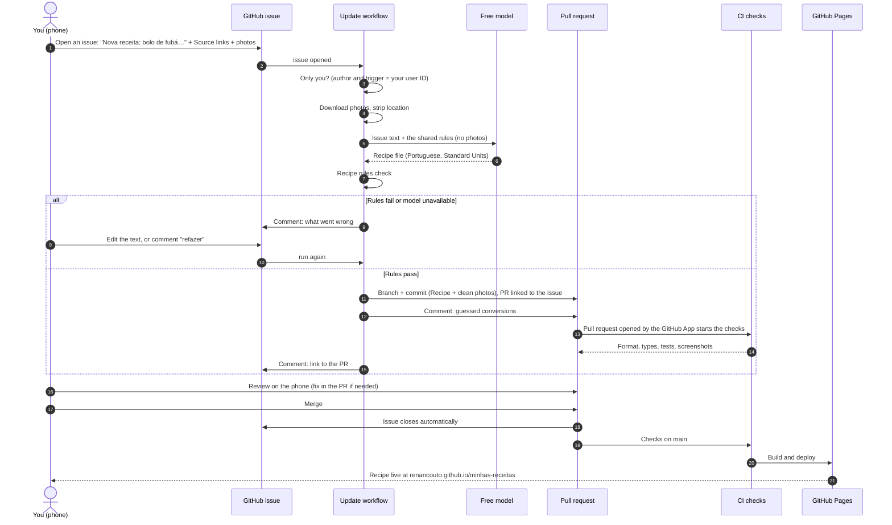

# Requests: from the phone to the live site

- Logging a Cook or changing a Rating follows the same path, starting from a sentence like "fiz a carbonara hoje, 4 estrelas".
- Nothing is published before you merge the PR.
