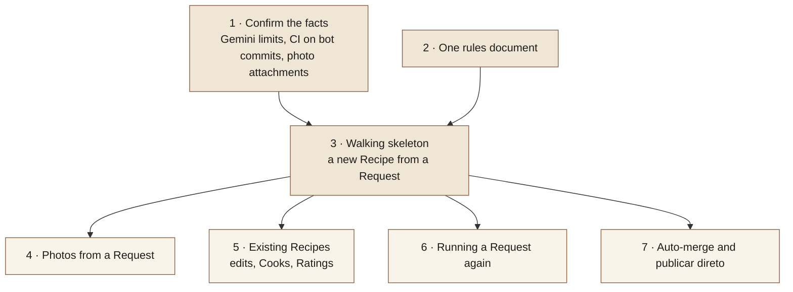

# Ticket dependencies

- 1 and 2 can run in parallel. After 3, tickets 4 to 7 can run in parallel.
- 1 has an owner-only step (attaching a test photo from the phone); 3 needs the owner to add the Gemini API key.
