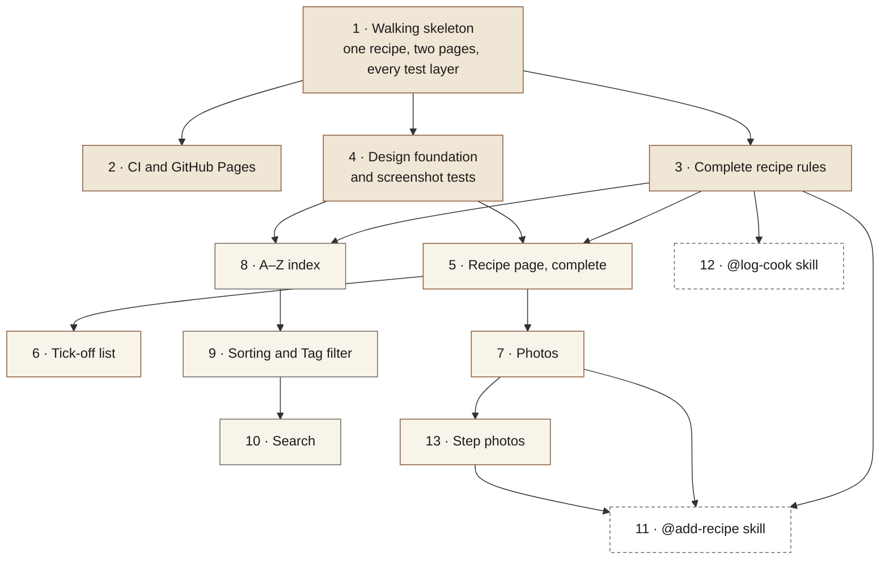

# Ticket dependencies

- Shaded: foundation. Brown border: Recipe page. Grey border: index. Dashed: agent skills.
- After 1, tickets 2, 3 and 4 can run in parallel. After 3 and 4, the Recipe page (5–7), the index (8–10) and `@log-cook` (12) can run in parallel.
